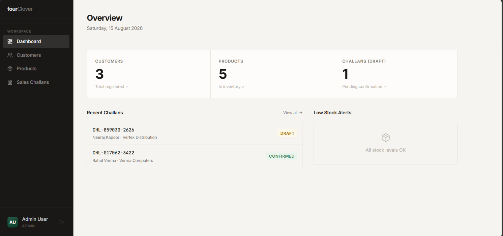
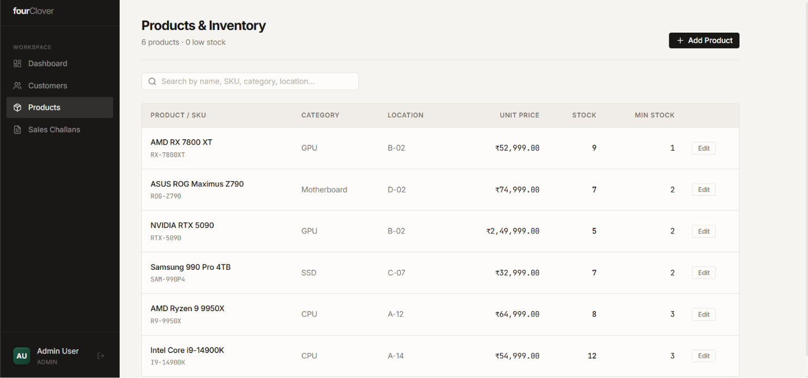
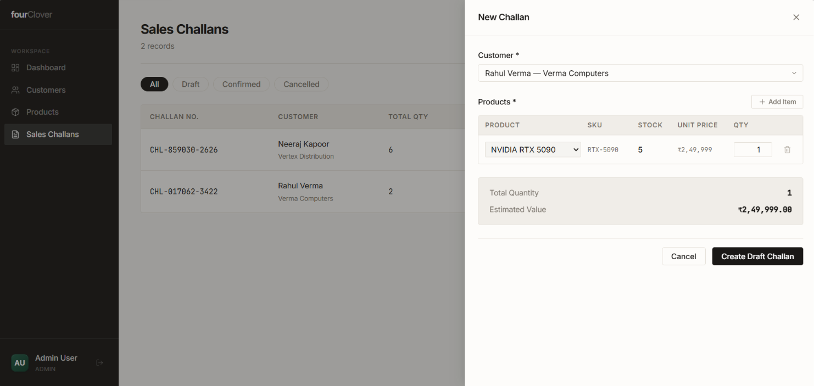

# fourClover ERP CRM

A modern, enterprise-grade ERP and CRM application tailored for Sales, Inventory/Warehouse, and Accounts management. 

Built with React (Vite), Node.js, Express, and Render PostgreSQL.

---

##  Screenshots
<p align="center">
  
  <br/>
  <br/>
  
  <br/>
  <br/>
  
</p>

---

## 1. Submission Links
- **GitHub Repository**: https://github.com/ranavic/fourclover-erp-crm
- **Live Frontend URL**: https://fourclover-frontend-7ns6.onrender.com/
- **Live Backend API URL**: https://fourclover-erp-crm-jgh6.onrender.com/

---

## 2. Test Login Credentials
Role-based access is strictly enforced on the backend and frontend. Use the following credentials to test different permissions:

| Role | Email | Password | Access Level |
|---|---|---|---|
| **ADMIN** | `admin@fourclover.com` | `Password123` | Full access to all modules |
| **SALES** | `sales@fourclover.com` | `Password123` | Can view/create Customers & Challans, view Products |
| **WAREHOUSE** | `warehouse@fourclover.com` | `Password123` | Can view/create Products & Stock movements |
| **ACCOUNTS** | `accounts@fourclover.com` | `Password123` | Can view Products & Stock history |

---

## 3. Setup & Deployment Instructions

###  Local Setup

Getting the project running locally is straightforward.

**1. Setup the Database**
- Create a PostgreSQL database (e.g. `fourclover_erp` locally or via Render PostgreSQL).
- Run `npm run db:init` in `backend` to automatically apply `backend/schema.sql` and seed default users.

**2. Setup the Backend**
```bash
cd backend
npm install
```
- Create a `.env` file using `.env.example` as a template.
- Fill in your `DATABASE_URL` (e.g., Render PostgreSQL External URL) or local PostgreSQL credentials and a secure `JWT_SECRET`.
```bash
npm run db:init   # Creates tables and seeds default users
npm run dev       # Starts backend API on http://localhost:5000
```

**3. Setup the Frontend**
```bash
cd frontend
npm install
```
- Create a `.env` file and add: `VITE_API_URL=http://localhost:5000`
```bash
npm run dev
```

###  Deployment Architecture

The application is fully prepared for cloud deployment:

- **Database (Render PostgreSQL)**: Hosted on Render PostgreSQL.
  > *Note:* Cloud databases require SSL. The backend connection pool is already configured with `{ rejectUnauthorized: false }` to support Render PostgreSQL and cloud providers natively.
- **Backend API (Render)**: Deployed as a Node Web Service. Inject `DATABASE_URL` and `JWT_SECRET` via the Render dashboard.
- **Frontend UI (Vercel / Netlify / Render)**: A standard Vite React app. 
  - **Build Command**: `npm run build`
  - **Publish Directory**: `dist`

---

## 4. API Documentation / Postman Collection
A complete **Postman Collection** is included in the root directory: `postman_collection.json`. 

You can import this file directly into Postman to test all endpoints. 
**Note:** Run the `Login` request first (`admin@fourclover.com` / `Password123`) — the built-in Postman test script will automatically extract and save the JWT token to the `{{TOKEN}}` collection variable for all subsequent requests.

---

## 5. System Architecture
The application follows a standard **3-Tier Architecture**:
1. **Presentation Layer (Frontend)**: React 19 + Vite + TypeScript. Uses React Router for navigation and Context API for global Authentication state. Uses a custom Axios interceptor to automatically attach JWT tokens and handle 401 redirects.
2. **Application Layer (Backend)**: Node.js + Express + TypeScript. Utilizes role-based access control (RBAC) middleware for strict route protection.
3. **Data Layer (Database)**: PostgreSQL deployed on Render. Uses `pg` (node-postgres) with a robust connection pool. Client transactions (`BEGIN`, `COMMIT`, `ROLLBACK`) with row-level locks (`FOR UPDATE`) are used when confirming Sales Challans to ensure atomic stock decrement and status updates.

**Key Design Patterns**:
- **JWT Stateless Auth**: No session state is stored on the server.
- **Service/Controller Pattern**: Controllers handle HTTP lifecycle, models/db execute queries.
- **CSS Modules & Variables**: A premium, highly consistent UI built entirely with vanilla CSS variables and CSS modules (no component libraries like Tailwind/MUI were used, ensuring full custom design control).

---

## 6. Known Limitations & Incomplete Parts
- **PDF Generation**: The backend contains a `pdfkit` module to generate Challan PDFs, but it requires further tuning for absolute layout perfection on mobile views.
- **Pagination**: API endpoints currently return all rows and handle sorting/searching, but hard pagination (`LIMIT` / `OFFSET`) is not yet implemented for massive datasets (10,000+ rows).
- **Password Reset**: The user management system currently lacks a self-service password reset flow (no email SMTP service integrated yet).
